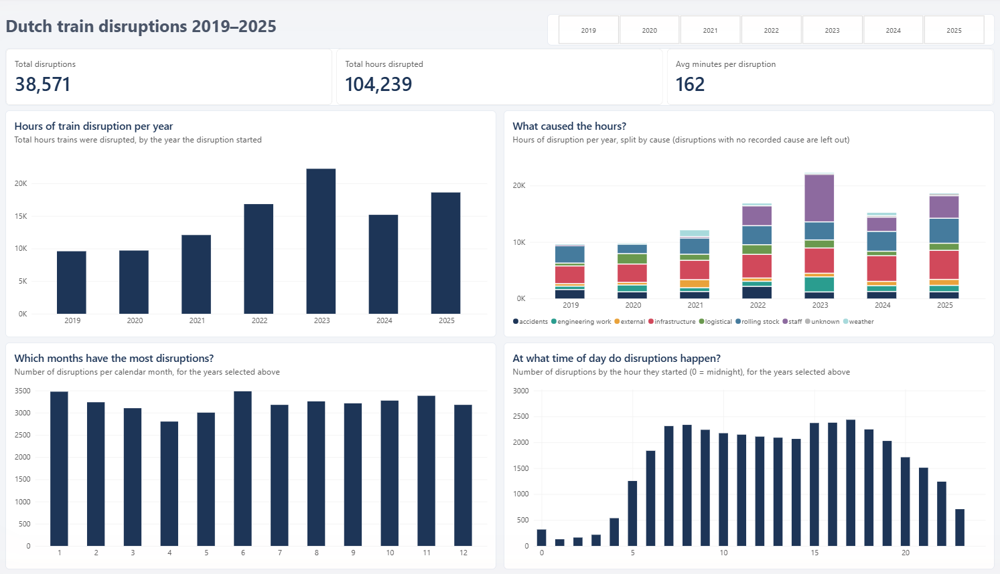
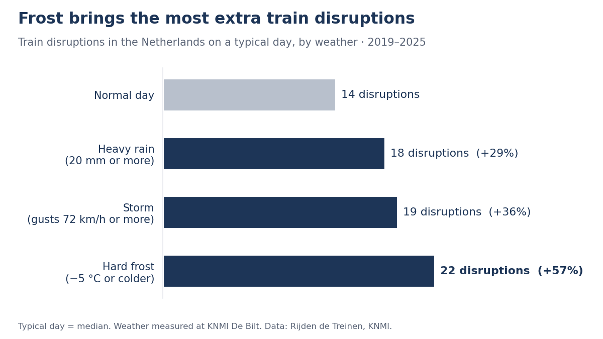
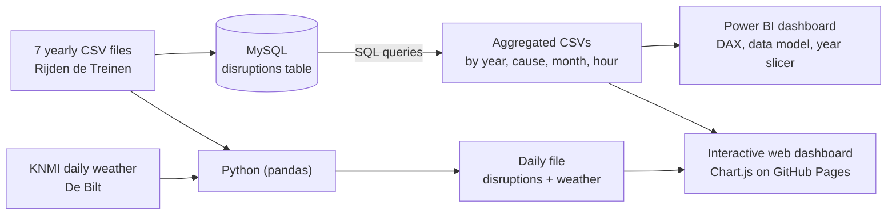

# Are Dutch trains getting worse? 🚆

An analysis of **38,571 train disruptions** in the Netherlands, 2019–2025: how much time is lost, what causes it, when it happens, and whether the weather makes it worse.

**Disruption time** = how long a disruption lasted, from start to end (not the delay of individual passengers). Every reported disruption counts, even short ones: 15% lasted under 10 minutes.

**[▶ Open the interactive dashboard](https://lervindelarosa-gif.github.io/trains/)** · **[📄 Full report (PDF)](dashboard/train-delays-dashboard.pdf)** · **[📊 Power BI file](dashboard/train-delays-dashboard.pbix)**

[](https://lervindelarosa-gif.github.io/trains/)

| Disruptions | Disruption time (hours) | Typical disruption (median) | Disruptions over 8 hours |
|---|---|---|---|
| **38,571** | **104,239** | **47 min** | **2,089** |

## Key findings

1. **Disruptions got longer, not just more frequent.**
   There are only 12% more disruptions than in 2019 (5,940 → 6,676 in 2025), but the total disruption time almost doubled (9,592 → 18,610 hours). A *typical* disruption is only a bit longer (median 40 → 51 minutes). The big change is the very long ones: disruptions of **more than 8 hours went from 159 to 413 a year (2.6×)**. In most years, the longest 5% of disruptions cause about half of all disruption time.

2. **2023 was the worst year, mostly because of strikes.**
   Staff causes made up 38% of all disruption time in 2023 (8,426 hours). About 4 in 5 of those hours came from **strikes at regional train companies**, mainly **Arriva** and **Keolis**, early in the year. The rest was mostly staff shortages.

3. **Infrastructure is the biggest cause overall.**
   28,162 hours over 2019–2025, ahead of rolling stock (broken trains, 22,078) and staff (18,869).

4. **Disruptions follow the rush hour, not the seasons.**
   They peak in the morning (7:00–9:00) and late afternoon (15:00–18:00); 17:00 is the busiest hour. At night (1:00–3:00) there are almost none. Months differ little: April is the quietest, June the busiest.

> **Why the median?** Durations are very skewed: most disruptions take under an hour, a few last days. The average (97 → 167 minutes) and the standard deviation are pulled up by those few, so I compare the median and the number of very long disruptions instead. I compare with 2019, the last normal year before covid (2020–2021 had clearly fewer disruptions).

## Part 2: Does the weather make it worse?



I joined the disruptions per day with daily weather from KNMI station **De Bilt** (2,557 days) and compared a normal day with days of extreme weather.

| Weather at De Bilt | Days | Disruptions on a typical day | vs normal day | Disruption time on a typical day (hours) |
|---|---|---|---|---|
| Normal day | 2,434 | 14 | – | 23 |
| Heavy rain (20 mm or more) | 40 | 18 | **+29%** | 39 |
| Storm gusts (72 km/h or more) | 57 | 19 | **+36%** | 36 |
| **Hard frost (−5 °C or colder)** | 33 | **22** | **+57%** | **53** |

- **On a normal day, the weather barely matters.** The correlation between weather and disruptions per day is about zero.
- **Extreme weather does matter, and frost the most:** frozen switches and ice on the overhead wires.
- **Leaf fall (herfstblad) is real but small.** Slippery-rail disruptions cluster in October–November, but those months have only 4% more disruptions per day than the rest of the year.
- **Storm days stand out:** 9 Feb 2020 (25 m/s gusts, 38 disruptions) and 2 Nov 2023 (23 m/s gusts, 59 disruptions).

## Who could use this, and what I would recommend

For a rail operator or the rail network manager, this analysis points to where the biggest gains are:

1. **Focus on the very long disruptions.** Disruptions of more than 8 hours went up 2.6× and the longest 5% cause about half of all disruption time. Faster recovery from big incidents would save more time than preventing many small ones.
2. **Start with infrastructure.** It is the largest cause over 2019–2025 (28,162 hours), ahead of broken trains and staff.
3. **Prepare for frost.** Hard-frost days have 57% more disruptions than a normal day, so switch heating and extra repair crews on those days are worth planning for.
4. **Plan cover for strikes and staff shortages.** These made 2023 the worst year, so back-up plans with regional operators help.
5. **Add passenger numbers next.** This data shows how often trains are disrupted, not how many travellers are affected; adding passenger counts would show the real cost.

## How it works



| Step | Tool | Files |
|---|---|---|
| Load 7 yearly CSV files into one table | MySQL | `sql/01_setup.sql`, `sql/03_load_all_years.sql` |
| Explore with analysis questions | MySQL | `sql/02_questions.sql` |
| Aggregate data for the dashboard | MySQL → CSV | `sql/04_dashboard_data.sql` → `dashboard/by_*.csv` |
| Build the dashboard | Power BI Desktop | `dashboard/train-delays-dashboard.pbix` |
| Compare with daily weather | Python (pandas) | `analysis/weather_vs_disruptions.py` → `dashboard/by_day_weather.csv` |
| Weather chart | Python (matplotlib) | `analysis/weather_chart.py` → `dashboard/weather_chart.png` |
| Data for the web dashboard | Python | `analysis/build_web_data.py` → `data.json` |

**Power BI features used:** a data model with `by_year` as the hub table (one-to-many on `year`, so one slicer filters every visual) · DAX measures (`Total disruptions`, `Disruption time (hours)`, `Avg minutes per disruption` with `DIVIDE`) · KPI cards · Power Query (M) · a custom report theme (`dashboard/train-delays-theme.json`).

```
├── disruptions-2019.csv … disruptions-2025.csv   raw data (Rijden de Treinen)
├── sql/                 setup, loading, analysis and dashboard queries
├── analysis/            Python: weather comparison, weather chart, web data
└── dashboard/           Power BI file, PDF report, images, aggregated CSVs
```

## Run it yourself

1. **SQL:** run `sql/01_setup.sql`, then `sql/03_load_all_years.sql` in MySQL (change the file paths in the `LOAD DATA` lines). Run each query in `sql/04_dashboard_data.sql` and export it as the CSV named above it.
2. **Power BI:** open the `.pbix` file. If it can't find the CSVs, go to **Transform data → Data source settings**, point it to your `dashboard` folder, then **Refresh**.
3. **Weather (Python):** download `etmgeg_260.zip` from the KNMI and unzip it into `weather/`, then run `python analysis/weather_vs_disruptions.py` and `python analysis/weather_chart.py` from the repository root.

## Data and limitations

- **Disruptions:** [Rijden de Treinen](https://www.rijdendetreinen.nl) open data, licensed under [CC BY 4.0](https://creativecommons.org/licenses/by/4.0/). Raw yearly files included.
- **Weather:** daily data for station De Bilt (260) from the [KNMI](https://www.knmi.nl). The raw file is not included; see step 3 above.
- Cause figures leave out disruptions with no recorded cause.
- Weather comes from one station in the middle of the country, so a storm on the coast can be stronger than De Bilt measured.
- Planned cancellations are not disruptions in this data. On the windiest day (storm Eunice, 18 Feb 2022, 31 m/s gusts) there were only 4 disruptions, probably because trains were stopped in advance.
- The data has no passenger or train counts, so it shows how often disruptions happen, not how many travellers were affected.
